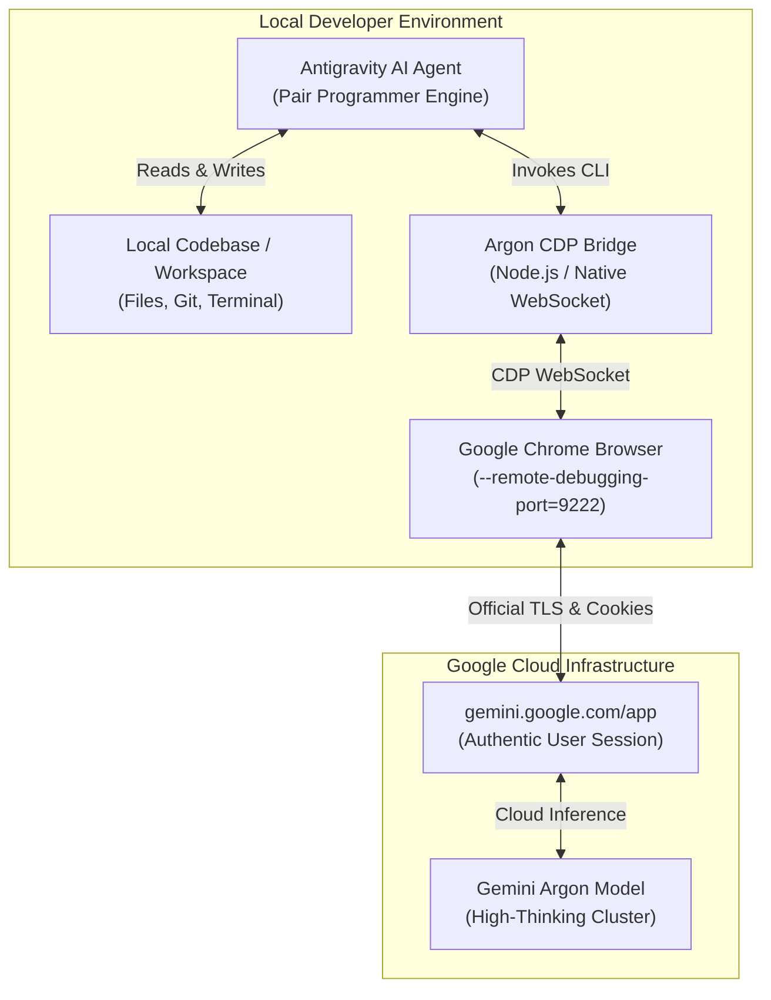
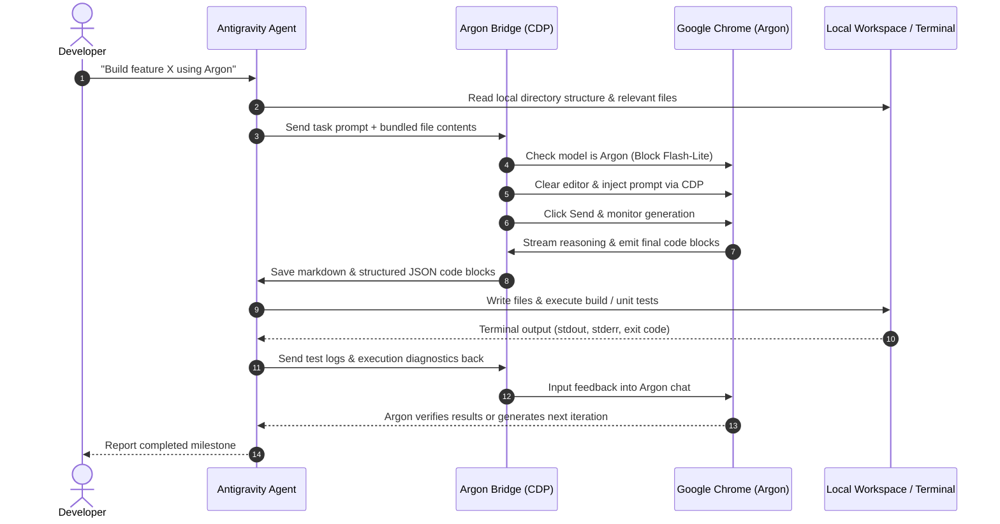

# ARGON Skill: Autonomous Gemini Browser Bridge for Google Antigravity

[](LICENSE)
[](https://nodejs.org/)
[](https://chromedevtools.github.io/devtools-protocol/)
[](package.json)
[](https://antigravity.google/)

**ARGON Skill** is a production-grade, two-way autonomous bridge connecting **Google Antigravity** with **Gemini Argon (and thinking models)** running in Google Chrome via the **Chrome DevTools Protocol (CDP)**.

It pairs Gemini's deep reasoning and thinking capabilities inside your authentic browser session with Antigravity's local system execution engine—enabling Gemini to autonomously design architectures, inspect local files, run terminal builds, debug runtime errors, and iterate on complex software projects.

---

## System Architecture

The following diagram illustrates how Antigravity orchestrates the development loop between your local workspace and your Google Chrome Gemini web session:



---

## Two-Way Autonomous Workflow



---

## Architectural Advantages: Why CDP?

| Approach | Security & Reliability | Zero-Ban Safety | Local File Access | Maintenance Cost |
| :--- | :--- | :--- | :--- | :--- |
| **ARGON CDP Bridge (This Skill)** | **Optimal (Native & Resilient)** | **Zero Risk** (Authentic Browser TLS & Session) | **Full** (Piped through Antigravity) | **Minimal** (Update-proof) |
| **Reverse Engineering Client** | Fragile (Breaks on client updates) | High Risk (Integrity checks fail) | Requires local model weights | Extremely High |
| **Unofficial Web Scraping / APIs** | Unstable (Protobuf / Anti-bot checks) | High Risk (Account suspension) | None | Constant Breakage |
| **Official API Keys** | Native & Clean | Zero Risk (Official) | Full (via SDK) | Separate billing / quotas |

---

## Strict Argon Mode: Flash-Lite Safeguard & Zero Fallback

On consumer Google accounts, reaching the quota limit for reasoning models typically triggers an automatic fallback to **Flash-Lite**.

When engineering complex codebases, responses from a non-thinking lightweight model can introduce regressions or low-fidelity code. **ARGON Skill enforces strict model guardrails:**

1. **Pre-Flight Verification:** Prior to sending any prompt, the bridge checks the active mode picker. If the model has switched to Flash-Lite, the request is immediately aborted with exit code `2`.
2. **Zero Internal Fallback:** The skill definition strictly forbids the Antigravity agent from answering the coding task on its own using internal models (like Gemini Flash). If Argon is rate-limited or offline, the agent halts and informs the user rather than secretly substituting a weaker model.
3. **Quota Banner Extraction:** If a quota exhaustion banner is detected, the bridge parses the exact reset timestamp and reports:
   ```text
   [BLOCKED] Argon limit reached (resets on 20 Oct at 2:52 pm). Flash-Lite is completely blocked.
   ```
4. **Mid-Stream Watchdog:** If an active session is demoted mid-generation, all pending Flash-Lite text is discarded to preserve code integrity.
5. **Self-Healing Auto-Launch:** If Chrome was closed or your machine was restarted, the bridge automatically launches Chrome with `--remote-debugging-port=9222`, opens the Gemini web app, and re-establishes the connection without requiring manual terminal commands.

---

## Quickstart & Installation

### 1. Prerequisites
* **Node.js** >= 20.0.0 (built-in native `WebSocket` and `fetch` support; no `npm install` needed)
* **Google Chrome** (or Chromium)
* **Google Antigravity**

---

### 2. One-Click Automated Install

#### On Windows (PowerShell):
```powershell
git clone https://github.com/Manimaran-tech/argon-skill.git
cd argon-skill
.\install.ps1
```

#### On macOS / Linux (Bash):
```bash
git clone https://github.com/Manimaran-tech/argon-skill.git
cd argon-skill
chmod +x install.sh && ./install.sh
```

The installer copies the skill and its scripts into your global Antigravity configuration directory (`~/.gemini/config/skills/argon/`), making it immediately accessible across **all workspaces and chats**.

---

### 3. Launch Chrome with Remote Debugging

The skill includes automated cross-platform launchers that start Chrome with an isolated debug profile so it never conflicts with your primary browsing windows:

* **Windows:**
  ```powershell
  pwsh -File scripts/launch_chrome_cdp.ps1
  ```
* **macOS / Linux:**
  ```bash
  bash scripts/launch_chrome_cdp.sh
  ```

Once Chrome launches:
1. Log in to your Google Account at `https://gemini.google.com/app`.
2. Select the **Argon** model in the mode picker.

---

## Using in Antigravity

Once installed, simply open any chat in Antigravity and prompt your agent:

> *"Use the `argon` skill to review `src/auth.ts`, refactor the token validator, and test the build."*

Antigravity will automatically:
1. Read `src/auth.ts` from your workspace.
2. Pipe the code into your Chrome Argon chat.
3. Wait for Argon's step-by-step reasoning.
4. Extract the refactored code blocks and apply them to your files.
5. Execute your local test suite and feed the output back to Argon.

---

## CLI Reference

The bridge CLI can also be used directly from your terminal:

```bash
# Check connection, active model, and limit status
node scripts/gemini_bridge.js read

# Send a prompt to Argon (aborts if in Flash-Lite)
node scripts/gemini_bridge.js send "Analyze this architecture"

# Wait for reasoning to finish and export code to a specific workspace
node scripts/gemini_bridge.js wait --dir "/path/to/project"

# Full roundtrip: Send prompt and wait for full response
node scripts/gemini_bridge.js send-and-wait "Generate a FastAPI server" --dir "."
```

---

## License & Attribution

Licensed under the **Apache License, Version 2.0**. See the [LICENSE](LICENSE) file for terms.

```text
Copyright 2026 Manimaran-tech and Argon Skill Contributors
```

Developed by **Manimaran K** ([@Manimaran-tech](https://github.com/Manimaran-tech)).
Inspired by the architecture and open-science engineering principles of [QuantumShield](https://github.com/Manimaran-tech).
